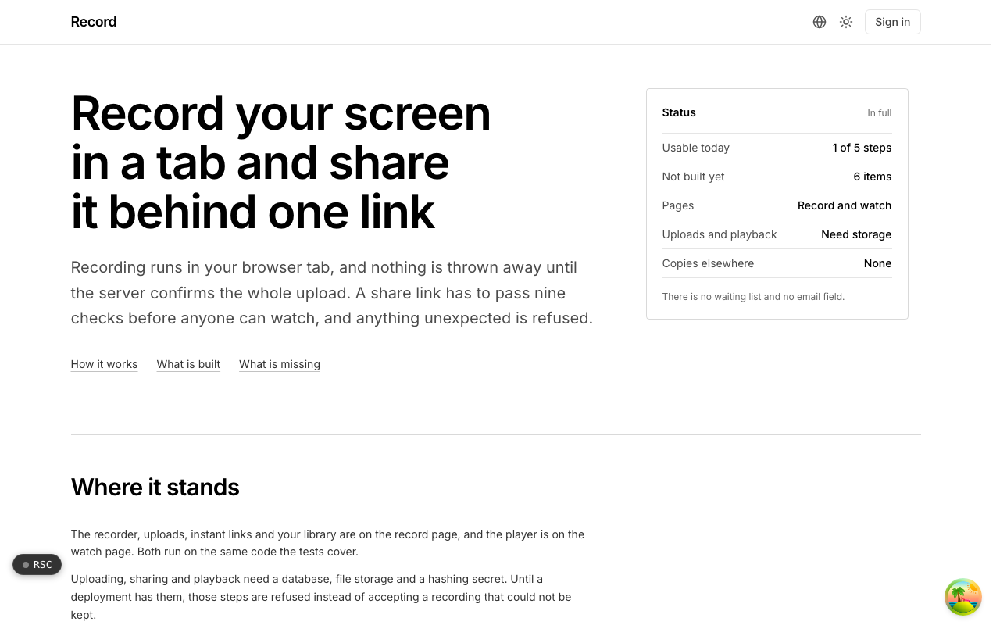

  <picture>
    <source media="(prefers-color-scheme: dark)" srcset=".github/assets/hero-dark.png">
    
  </picture>

# record.me.at

Record your screen in a tab and share it behind one link.

Record is async screen recording: record in the browser, get a share link, see who watched. Recording runs in your browser tab, and nothing is thrown away until the server confirms the whole upload. A share link has to pass a set of checks before anyone can watch, and anything unexpected is refused. The product is in an early, internal stage: the record and watch pages exist, and uploads and playback need storage configured before they work.

## Features

- **Browser capture**: screen recording with the browser's own screen-sharing and `MediaRecorder` APIs, no desktop app.
- **Resumable uploads**: chunked uploads that resume from the first missing part, with the local buffer released only after the server confirms.
- **Gated share links**: every view passes a fail-closed set of link controls, including a readiness check, before playback.
- **Short-lived playback**: recordings play through short-TTL signed URLs.
- **View analytics**: owners see who watched, with view time capped by the recording's own length.
- **Embeds**: a chrome-free player for iframes, discoverable through oEmbed.
- **Abuse reports and retention**: viewers can report a recording, and a daily sweep applies retention and cleans up abandoned uploads.
- **Optional transcripts**: sent to an OpenAI-compatible speech-to-text endpoint when one is configured.

## Built with

- Next.js 16 (App Router) and React 19
- TypeScript
- Tailwind CSS 4
- Drizzle ORM and Postgres
- S3-compatible object storage (Cloudflare R2)
- Better Auth (shared me.at account)

## Part of the me.at family

record.me.at is one of my [`*.me.at`](https://me.at) apps. They share one design system, account, and app shell. Development happens in a private monorepo; this repository is the project's public-facing home.

## License

See [LICENSE](LICENSE).
