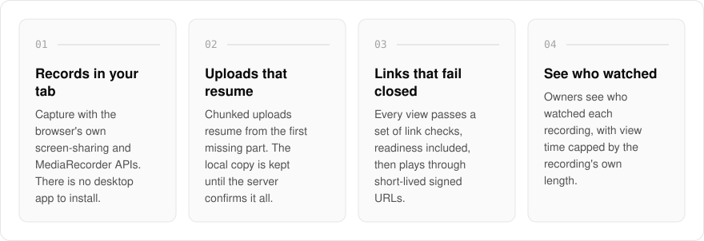
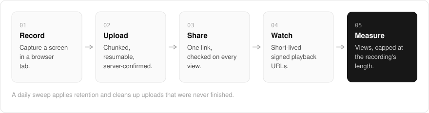

  <picture>
    <source media="(prefers-color-scheme: dark)" srcset=".github/assets/hero-dark.png">
    
  </picture>

<h1 align="center">record.me.at</h1>

<strong>Record your screen in a tab and share it behind one link.</strong>

  
  
  

  <a href="#features">Features</a> ·
  <a href="#how-it-works">How it works</a> ·
  <a href="#built-with">Built with</a>

Explaining something on a call costs everyone a meeting, and most screen recorders want a desktop app first. I built record.me.at for async screen recording: record in the browser, get a share link, see who watched. Recording runs in your browser tab, and nothing is thrown away until the server confirms the whole upload. A share link has to pass a set of checks before anyone can watch, and anything unexpected is refused.

> **Status:** in development, at an early internal stage. The record and watch pages exist, and uploads and playback need storage configured before they work.

  <picture>
    <source media="(prefers-color-scheme: dark)" srcset=".github/assets/overview-dark.svg">
    
  </picture>

## Why record.me.at

| The usual screen recorder | record.me.at |
| --- | --- |
| A desktop app to install | Records in the browser tab |
| A dropped connection loses the take | Uploads resume from the first missing part |
| A permanent file URL | Link checks on every view, then short-lived signed playback |
| View time that counts idle tabs | View time capped at the recording's own length |

## Features

- **Browser capture**: screen recording with the browser's own screen-sharing and `MediaRecorder` APIs, no desktop app.
- **Resumable uploads**: chunked uploads that resume from the first missing part, with the local buffer released only after the server confirms.
- **Gated share links**: every view passes a fail-closed set of link controls, including a readiness check, before playback.
- **Short-lived playback**: recordings play through short-TTL signed URLs.
- **View analytics**: owners see who watched, with view time capped by the recording's own length.
- **Embeds**: a chrome-free player for iframes, discoverable through oEmbed.
- **Abuse reports and retention**: viewers can report a recording, and a daily sweep applies retention and cleans up abandoned uploads.
- **Optional transcripts**: sent to an OpenAI-compatible speech-to-text endpoint when one is configured.

## How it works

  <picture>
    <source media="(prefers-color-scheme: dark)" srcset=".github/assets/flow-dark.svg">
    
  </picture>

The browser captures the screen and uploads it in chunks, resuming from the first missing part, and the local copy is released only once the server confirms the whole file. Each view of a share link passes a fail-closed set of checks, then plays through a short-lived signed URL, and view time is capped at the recording's length.

## Built with

  
  
  
  
  
  

- Next.js 16 (App Router) and React 19
- TypeScript
- Tailwind CSS 4
- Drizzle ORM and Postgres
- S3-compatible object storage (Cloudflare R2)
- Better Auth (shared me.at account)

## Part of the me.at family

record.me.at is one of my [`*.me.at`](https://me.at) apps. They share one design system, one account, and one app shell. Development happens in a private monorepo; this repository is the project's public-facing home.

## License

Source-available. See [LICENSE](LICENSE).
